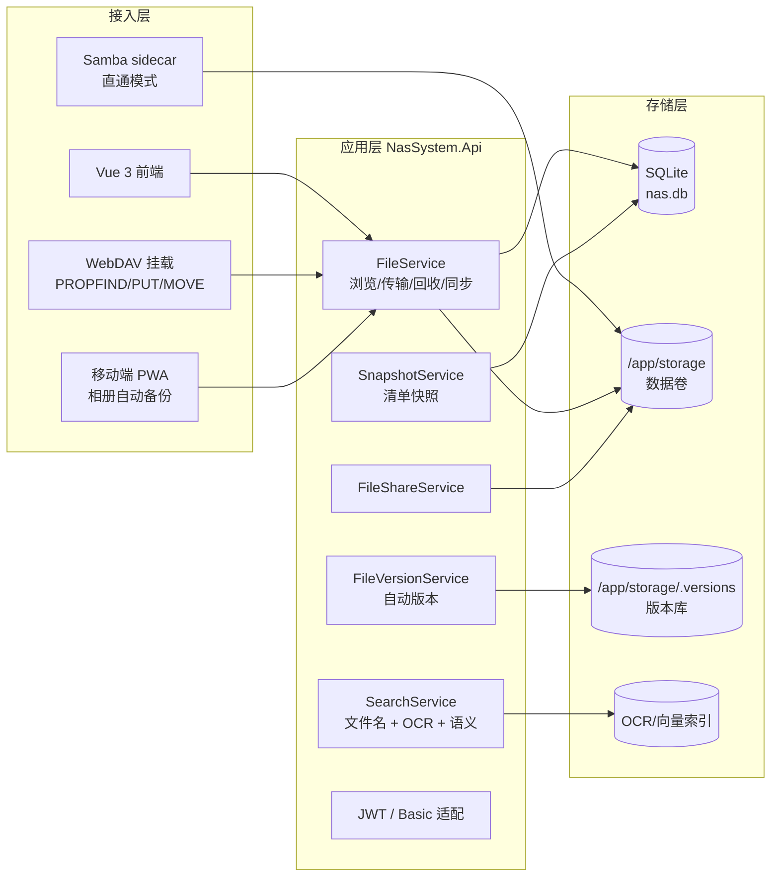

# NAS 系统改造完整方案

> 版本：v1.1（2026-10-18）｜ 状态：Phase 0 与 Phase 1 已实施（见 §8 进度）
> 依据：2026-10-18 项目全量功能盘点 + NAS 市场调研（绿联 UGOS Pro / 群晖 DSM 7.3 / 威联通 Qsirch / 极空间 / 飞牛 fnOS）

## 0. 结论先行

当前项目是「带存储能力的 Web 应用」，不是 NAS。差距不在工程质量（工程层面高于多数开源同类），而在三个本体能力缺失：协议层挂载、移动端备份、AI 检索。本方案按四阶段推进，总工作量约 4 到 6 个月（业余节奏），第一阶段两周内可交付第一个可感知成果（Windows 资源管理器直接挂载）。

核心判断：这个项目的最优路线不是对标群晖做全功能套件，而是守住「自托管 + 数据不出户 + 部署极简」的定位，把协议层和备份链补齐，AI 做轻量落地（OCR 先行，语义搜索验证后上），硬件层能力（RAID、UPS、SMART）明确划出软件边界。

## 1. 现状与差距定位

| 维度 | 现状 | 市场基线 | 判定 |
|---|---|---|---|
| 协议层（SMB/WebDAV/NFS） | 无，仅 HTTP API | NAS 本体能力 | P0 缺口 |
| 移动端与相册备份 | 无 | 家庭第一场景 | P0 缺口 |
| 文件版本 | 后端全有，前端无，不自动产版本 | 主流标配 | 半成品，补齐成本低 |
| 快照与防勒索 | 无 | 2026 企业选型护城河 | P1 缺口 |
| AI 检索（OCR/语义） | 无 | 2026 主线竞争力 | P1 缺口 |
| 外网访问（无公网 IP） | 无 | 新势力标配 | P1 缺口 |
| 媒体库/影视墙 | 仅缩略图 | 家庭娱乐核心 | P2 缺口 |
| 文件管理/分享/配额 | 完成度高，强于多数开源同类 | 持平或超出 | 优势保持 |

## 2. 目标架构总览

三条设计红线贯穿全方案：

1. **所有写操作走应用层**（WebDAV/PWA 均通过 FileService），配额检查、软删除、SignalR 推送不被旁路。唯一例外是 SMB sidecar，定位为管理员直通模式，文档明示不受配额与回收站约束。
2. **新实体一律走 PalORM 迁移 + schema 锁定测试**（本库已有索引/外键/LIKE 转义三个坑的教训），不启用会话池（实测负优化），SQLite 侧不做往返压缩（本地 SQLite 往返成本近似为零，压往返/JOIN/投影实测全慢）。
3. **不自建云服务**。外网访问用配置生成器对接成熟方案（Cloudflare Tunnel/frp/Tailscale），不运营中继服务器。

## 3. 分阶段方案

### Phase 0：协议层落地（约 2 到 3 周）

**目标**：让 Windows/macOS/Linux 资源管理器能像操作本地磁盘一样挂载 NAS。这是从 Web 应用变成 NAS 的标志性一步。

**功能清单**：

| 功能 | 说明 |
|---|---|
| WebDAV 最小子集 | OPTIONS / PROPFIND / GET / HEAD / PUT / MKCOL / DELETE / MOVE / COPY，挂载于 `/dav` |
| Basic 认证适配 | WebDAV 客户端不支持 Bearer token，用 Basic auth（仅 HTTPS），密码位接受 JWT 或专用应用密码 |
| 大文件放开 | `/dav` 路由 `DisableRequestSizeLimit` + Kestrel `MaxRequestBodySize` 单独配置，与现有 500MB 网页上传上限解耦 |
| SMB 直通（sidecar） | docker-compose 增加 samba 容器共享 `/app/storage` 卷，后端生成 smb.conf，UID 与 nasuser 对齐 |
| 客户端兼容验证 | Windows MiniRedir、macOS Finder、Linux davfs2、iOS 文件 App 四端挂载测试 |

**技术选型**：

自研最小 WebDAV 处理器（约 800 到 1200 行），不复用第三方 WebDAV 服务端库。理由：社区库（NWebDav.Server.AspNetCore、FubarDevelopment/WebDavServer）自带文件系统抽象，会旁路本项目的配额检查、软删除、扫描同步与 SignalR 推送；WebDAV 最小子集是边界清晰的协议面，适配到现有 FileService 的代码量小于改造第三方库适配层的成本。若实现受阻，回退到 NWebDav 并评估其 .NET 11 兼容性（需先验证，不可直接断言）。

SMB 走 sidecar 而非进程内：.NET 无成熟 SMB 服务端库，进程内实现不现实；sidecar 共享卷是容器部署下的标准解法。

**验收标准**：
- 四端挂载后：浏览、上传、下载、新建文件夹、重命名、删除（落回收站）全部通过
- WebDAV 上传触发配额超限时返回 507 且不落脏数据
- WebDAV 的文件变更在网页端 SignalR 实时可见
- Windows 下 4GB 单文件上传成功（Range 续传由客户端负责，服务端保证流式不缓冲全文件）

**文档债务同批清理**（零成本，不改代码语义）：README 补齐近十次提交功能；REQUIREMENTS.md 上传上限 1GB 与实现 500MB 对齐（建议文档改 500MB，与 Kestrel 同源）；DESIGN.md 删除 FluentValidation/Validators 幽灵章节。

---

### Phase 1：文件版本闭环 + 移动备份（约 3 到 4 周）

**目标**：补上数据保护的第一块拼图，打开手机备份通道。

**功能清单**：

| 功能 | 说明 |
|---|---|
| 自动版本 | 上传覆盖/永久删除前，将原文件 Copy-on-Write 到 `{池挂载点}/.versions/{fileItemId}/{时间戳}-{文件名}` |
| 版本策略 | 按数量（默认 10 个）+ 天数（默认 30 天）+ 单文件大小上限三重淘汰，超限异步清理（阈值为动态配置，见 §8） |
| 版本 UI | 文件详情抽屉的版本页：列表、下载、恢复、删除、大小/时间 |
| 备份设备管理 | 设备注册/枚举/吊销，按设备隔离目录 `Backups/{deviceId}/` |
| 增量备份 API | 清单 diff（客户端上报路径+体积清单，服务端按体积比对返回差异）、文件级续跳、Wi-Fi/充电状态标记 |
| 移动端入口 | PWA（manifest + Service Worker）+ 相册上传页，原生 App（Flutter 或 uni-app）列为二期评估项 |

**技术选型**：

版本存储用文件系统硬链接或副本，不用数据库存字节。硬链接在 NTFS 与 ext4 均可用，未修改时不占额外空间；修改时破坏链接生成新副本。备份 API 复用现有上传管道（MultipartReader 流式解析已验证过），清单 diff 按路径+体积比对（同体积不同内容的漏检由客户端对单条报体积 -1 强制重传兜底），不引入新传输机制。

移动端先做 PWA 而非原生 App：PWA 两周可交付且覆盖 Android 主力场景，iOS Safari 的后台同步限制通过「打开即备份」缓解；原生 App 的投入产出比在用户量未验证前不成立。

**验收标准**：
- 覆盖上传同一文件 10 次后，版本列表恰好 10 条，恢复第 3 次内容一致
- 淘汰策略触发后版本库总大小不超过配置上限
- 手机浏览器完成相册 50 张增量备份，杀进程重进后不重传已完成文件（文件级续跳；下载侧支持 Range）
- 版本操作纳入 SignalR 推送与扫描同步口径

---

### Phase 2：快照备份 + OCR 搜索（约 4 到 6 周）

**目标**：防误删升级到防勒索的最小可行形态；搜索从「按文件名」扩展到「按内容」。

**功能清单**：

| 功能 | 说明 |
|---|---|
| 目录清单快照 | 定时（可配置 cron）记录目录树 + 文件 hash，支持按时间点对比与恢复 |
| 关键目录只读保护 | 管理员标记的目录在应用层禁止覆盖/删除，防勒索软件经 WebDAV 篡改 |
| 3-2-1 导出 | 打包下载到外部存储（复用流式 ZIP 能力），支持加密压缩包 |
| 图片 OCR | 提取图片内文字写入索引，搜索可命中扫描件/截图 |
| 全文检索升级 | OCR 文本入 SQLite FTS5（或自建倒排，视 PalORM schema 约束定） |
| 语义搜图（探针先行） | ONNX Runtime + 轻量 CLIP 模型，向量存 SQLite，自然语言搜图 |

**技术选型与探针门**：

OCR 用 PaddleOCR 的 ONNX 导出模型（中文场景识别率高于 Tesseract），复用已有 SkiaSharp 做预处理。语义搜图是本方案最大的不确定项，动工前必须完成 10 分钟探针（AGENTS.md 大方案前置门）：验证 ① 轻量 CLIP 模型在本机 CPU 的单张推理延迟（目标 < 300ms，否则只做离线建索引不做实时）② 向量存储方案（sqlite-vec 扩展与 PalORM 原生引擎 SQLite3MC 的共存性，冲突则退化为主外键表 + float blob 暴力检索）③ 10 万张图的建索引总耗时（决定是否默认开启）。三项任一不过，语义搜图降级为 Phase 4 或砍掉，OCR 不受影响。

快照做清单级而非块级：Btrfs 块级快照依赖文件系统，跨 Windows 开发机与容器 Linux 不一致；清单快照 + 版本库已能覆盖误删与轻度勒索场景，块级快照超出个人项目运维边界。

**验收标准**：
- 快照任务按配置触发，恢复某时间点后目录状态与快照记录逐条一致
- 只读目录经 WebDAV 与网页端均无法覆盖/删除，错误提示明确
- 含文字图片上传后 OCR 文本可被搜索命中（锁定测试：修复前红，修复后绿）
- 探针报告作为语义搜图开工/砍单的依据留档

---

### Phase 3：外网访问 + 媒体库（约 4 到 6 周）

**目标**：补齐新势力 NAS 的两个标志性体验：出门在外能访问、影音能管起来。

**功能清单**：

| 功能 | 说明 |
|---|---|
| 外网访问配置器 | 设置页生成 Cloudflare Tunnel / frp / Tailscale 配置，附连通性自检 |
| HTTPS 强制与证书 | ACME 自动化续期（现有 nginx 挑战目录已就位，需补自动续期任务） |
| 媒体库 | 按目录聚合图片/视频/音频，时间线视图，EXIF/时长/码率元数据 |
| 视频转码（二期） | FFmpeg HLS 按需转码，NAS 侧 CPU 编码，移动端播放 1080p 子流 |
| 海报墙刮削 | TMDB API 刮削（key 用户自备），海报/简介/演员入库 |

**技术选型**：

外网访问不自建中继（云成本与运维超出个人项目边界），做配置生成器 + 连通性诊断页，默认推荐 Cloudflare Tunnel（免费额度覆盖个人场景、无需公网 IP、自带 HTTPS）。媒体元数据用 TagLib#（成熟 .NET 音频/视频标签库）+ 自写 MP4 时长解析，视频转码调 FFmpeg（Dockerfile apt 安装，需重估镜像体积与 ReadyToRun 链路）。海报墙刮削依赖 TMDB 外部 API，key 用户自备，无 key 时媒体库仍可用只是无海报。

**验收标准**：
- 按设置页生成的配置，外网 4G 网络下完成访问与文件下载
- 证书到期前 30 天自动续期成功（锁定测试：模拟临期）
- 媒体库打开 1000 文件目录首屏 < 2s（本地 SQLite 口径，不做往返优化）
- 无 TMDB key 时媒体库功能不降级

---

### Phase 4：生态扩展（按需，不排期）

云同步（rclone 模式对接 S3/OneDrive）、远程下载（HTTP/BT 任务入队）、应用中心入口（Docker 应用一键部署模板）、在线协作（评论/共享编辑）。此阶段各项独立，按实际使用频率触发，不预设完成时间。

## 4. 技术选型汇总

| 决策点 | 选择 | 放弃的备选与理由 |
|---|---|---|
| 协议层主力 | 自研最小 WebDAV | NWebDav/FubarDev 库：旁路配额/软删除/推送，适配成本更高；.NET 11 兼容性未验证 |
| SMB | samba sidecar | 进程内 SMB 服务端：.NET 无成熟库 |
| 移动端 | PWA 先行 | 原生 App：投入产出比在验证前不成立 |
| 版本存储 | 文件系统硬链接/副本 | DB 存字节：SQLite 不适合大 blob，违背零分配设计 |
| 快照 | 清单级 + hash | 块级/Btrfs：跨平台不一致，运维超边界 |
| OCR | PaddleOCR ONNX | Tesseract：中文识别率低 |
| 语义搜索 | ONNX + sqlite-vec（探针后定） | 引入专用向量数据库：SQLite 已是单一事实源，不增加运维面 |
| 外网访问 | Cloudflare Tunnel 配置器 | 自建中继云：成本与运维超边界 |
| 视频转码 | FFmpeg 子进程 | 库内集成（如 FFmpeg.AutoGen）：复杂度与内存风险不对等 |

## 5. 与现有架构的冲突点及处理

| 冲突 | 处理方式 |
|---|---|
| 软删除 + 回收站 vs WebDAV DELETE | WebDAV DELETE 走软删除；PROPFIND 不列回收站条目；永久删除仅应用层 |
| 500MB 上传上限 vs WebDAV 大文件 | `/dav` 路由级放开，与网页上传解耦，两处数字同源于配置 |
| 配额检查 vs SMB 直通 | sidecar 明示不受配额约束，仅管理员可用，文档与 UI 双告警 |
| 容器非 root vs samba UID | smb.conf 的 force user 与 nasuser UID 对齐，启动时校验，不一致即 fail-fast |
| PalORM schema 锁定 vs 新实体 | 版本元数据（已有 FileVersion）、备份设备、快照、OCR 索引均走迁移流程 + schema 锁定测试，防索引/外键/LIKE 转义三个已知坑 |
| 会话池/往返优化旧账 | 新代码不启用会话池，SQLite 访问不做往返压缩，延续既有实测结论 |
| 本机 dotnet test 损坏 | 验收按记忆中的既定做法直接跑测试 exe，不用 MTP 宿主 |

## 6. 风险与边界

**明确不做**（超出软件项目边界，文档明示）：RAID 管理、UPS 支持、硬盘 SMART 监控、物理盘位管理。这些由宿主机的 RAID 卡/系统层负责，Web NAS 通过现有驱动器信息端点展示即可。

**主要风险**：
- 语义搜图探针三项不过则砍单，不影响其他阶段（已设计降级路径）
- SMB sidecar 绕过应用层是特性也是风险，靠「仅管理员 + 文档明示」控制，不做配额同步
- iOS 后台备份受限是平台约束，PWA 方案缓解但不能根治，原生 App 是唯一正解但排在验证后
- FFmpeg 入镜像会显著增加体积（约 100MB 级），Phase 3 启动时重估 ReadyToRun 镜像链路

## 7. 验收总标准

每个 phase 独立可验收，阶段间不阻塞（Phase 2 的 OCR 索引可先于语义搜索上线）。总体完成的判据三条：四端挂载可用、手机备份可用、搜索能搜到图片里的字。三者达成，项目即完成从 Web 应用到 NAS 的形态升级；其余为竞争力加分项。

## 8. 实施进度（2026-10-18）

| 阶段 | 项 | 状态 | 提交 |
|---|---|---|---|
| Phase 0 | WebDAV 最小子集 + Basic 认证 + 507 配额映射 | 完成 | 47633dc |
| Phase 0 | SMB sidecar（compose + smb.conf 模板 + UID 对齐 + 文档） | 完成 | 47633dc |
| Phase 0 | 文档债务清理（README/REQUIREMENTS/DESIGN） | 完成 | 47633dc |
| Phase 1 | 文件版本闭环（自动产版本 + 保留策略 + 恢复同步 + FK 迁移 + 前端抽屉） | 完成 | cf83e2e |
| Phase 1 | 移动备份 API + PWA 入口 | 完成 | 97eca93 |
| Phase 2 | 图片 OCR（SimdPaddleOCR PP-OCRv6 + 搜索双通道） | 完成 | 8ba0af7 |
| Phase 2 | 快照备份（清单快照 + 只读保护 + 3-2-1 导出） | 完成 | 3655207 |
| Phase 2 | 语义搜图（探针门三项全过，CLIP 58ms + sqlite-vec 共存） | 完成 | 4cc3b58 |
| Phase 3 | 外网访问配置器（Cloudflare/frp/Tailscale） | 完成 | e69ae73 |
| Phase 3 | 媒体库（聚合 + 托管元数据解析 + 时间线） | 完成 | 14f216f |
| Phase 3 | 视频转码（FFmpeg HLS + 缩略图抽帧 + 前端播放） | 完成 | 本次 |

### 已落地能力摘要

协议层：`/dav` 挂载（OPTIONS/PROPFIND/GET/HEAD/PUT/MKCOL/DELETE/MOVE/COPY，Basic 认证 + 失败锁定），配额/软删除/实时推送全生效；SMB sidecar `--profile smb` 管理员直通。

版本与备份：覆盖上传与单文件永久删除前自动产版本（硬链接快照，默认 10 个/30 天）；恢复版本同步库中体积；版本在文件永久删除后仍可下载（FileItemId 级联外键已移除，存量库自动迁移）。备份设备注册/枚举/吊销 + 清单 diff 计划，文件传输走标准上传管道（备份文件就是 `/Backups/{设备名}/` 下的普通文件）；PWA 可安装 + 网络优先 Service Worker + 移动优先备份页（选文件/整夹 → 计划 → 增量上传）。

外网访问：设置页按 Cloudflare Tunnel / frp / Tailscale 生成配置与操作步骤（不自建中继云），未知方案回 400。

OCR 与媒体库：SimdPaddleOCR PP-OCRv6（纯 C# 推理，无 ONNX Runtime/OpenCV 原生依赖，AOT 友好），SkiaSharp 解码 + 引擎单例懒加载 + 并发闸；识别文本落稀疏表，搜索改「文件名 OR 图内文字」双通道（OCR 文本侧已升级 FTS5 trigram，中文子串检索；短查询回退 LIKE）。媒体库按类型聚合 + 时间线，元数据托管解析（图片尺寸 SkiaSharp、MP4/MKV 盒与 EBML、MP3 帧头/Xing），列表与元数据分离避免滚动触发解码。

清单快照与只读保护（Phase 2）：快照记库内目录树形态（路径/大小/hash/时间）不做物理扫描，diff 四态在 SQL 层按 FULL OUTER JOIN 判定；原生 BackgroundService + 自研最小 cron 驱动定时快照，保留策略超限淘汰；只读保护在 FileService 三条写路径拦截（上传覆盖/Move 整批预检/Delete per-item），WebDAV 与网页端共用 FileService 一处接线全覆盖；3-2-1 导出流式 ZIP 可选 AES-256-CBC 加密（openssl enc 兼容格式）。

语义搜图（Phase 2，探针结论 ADR-0003）：CLIP 双塔编码中位 58ms（门槛 300ms），模型四件套首次启用经设置页下载（hf-mirror 源，不入库）；向量存 sqlite-vec vec0 表（独立连接，PalORM 不暴露扩展加载），后台增量建索引（vec0 表即进度账本）；未就位时诚实降级不做假 UI。

视频转码（Phase 3）：FFmpeg 子进程 HLS 按需转码（libx264/CRF 23/veryfast，1080p 子流，6 秒分片，vod 播放列表），进程内并发闸 + 幂等缓存（物理路径 SHA256 为键）；视频缩略图从 1x1 占位升级为 ffmpeg 抽真实帧（不可用回落占位）；Dockerfile runtime 装 ffmpeg（约 100MB 级，ROADMAP 预告的重估项已兑现）；前端媒体库视频格点击经 hls.js 播放（token 经 xhrSetup 注入）。

验证基线：集成 223 + 单元 178 + 前端 136 全绿（MTP 宿主坏，直跑 exe）；oxlint 0 警告，vue-tsc 与生产构建通过。真实客户端挂载（Windows/macOS Finder/iOS 文件 App）、手机端到端备份、外网连通、中文扫描件识别率、CLIP 检索质量与 ffmpeg 转码画质需在部署环境人工验收。

## 9. 功能 UI 覆盖审计与配置收口（2026-10-18 补记）

审计结论：协议层（WebDAV/SMB）此前零 UI，配置项全部沉在 appsettings。收口后：

| 功能 | 菜单/页面 | 操作交互 | 配置入口 |
|---|---|---|---|
| WebDAV | 系统配置页服务卡（挂载地址 + 复制） | 启用开关、HTTP 放行开关 | 系统配置页 |
| SMB | 系统配置页服务卡（共享名 + 启用方式） | 只读信息 + 复制 | compose profile（环境变量） |
| 文件版本 | 预览抽屉（列表/下载/恢复/删除） | 保留策略数量/天数 | 系统配置页 |
| OCR | 预览抽屉（识别/重识别） | 上传后自动识别开关 | 系统配置页 |
| 移动备份 | 独立页（注册/选择/吊销/执行） | 完整 | 无（设备级操作即配置） |
| 媒体库 | 独立页（类型 tab/时间线/元数据） | 完整 | 无 |
| 外网访问 | 设置页区块（方案生成/复制） | 完整 | 无 |
| 目录批量 OCR | Files 工具栏按钮（选中文件夹可用） | 确认 + 汇总计数 + 刷新 | 无 |
| 缩略图缓存清理 | 预览抽屉页脚按钮（图片） | 清除 + 重取预览 | 无 |
| 版本对比 | 版本抽屉勾选两个 + 对话框 | 体积差/哈希/时间范围 | 无 |
| 重新生成分享码 | 分享编辑抽屉内 | 确认（明示旧链接失效）+ 刷新新码 | 无 |
| 重启/关机 | 配置页危险区 | 分级确认 + 真实调度（3 秒后停进程） | 无 |
| 缩略图缓存清理 | 预览抽屉（单文件）+ 配置页维护区（全局） | 确认 + 重取预览 / 全量重建提示 | 无 |

Phase 2/3-a 收口（2026-10-19）：快照与只读保护独立页（/snapshots，两 tab：快照管理 + 保护目录）；3-2-1 导出在快照页工具栏；语义搜图模型卡在系统配置页（状态/下载/进度），搜索入口在媒体库图片 tab；视频转码播放入口在媒体库视频格点击，缓存清理端点 DELETE /media/stream/cache（admin）。本轮新增端点的调用方全部经前端接线，无 API-only 遗留。

第三轮收口（2026-10-18 深夜）：机械审计（从 Endpoints 源码提取全部路由逐个核对前端调用方）发现 DELETE /thumbnails/cache 全局清理缺入口，已补配置页维护区。其余无调用方端点判定 API-only 保留：thumbnails/supported（前端直连 img，预检反增请求）、file-shares/{id}、files/info、storage/pools/{id}（列表数据已全量）；/system/logs 与 PUT /system/settings 为诚实 501 不做假 UI。

动态配置架构：`ConfigDescriptors` 注册表是前后端单一事实源（键/类型/范围/默认值/i18n 键），配置页按 descriptor 渲染表单；值存 `SystemSettings` 键值表，改完即生效不重启。appsettings 保留给启动期定死项（连接串/JWT/CORS/上传上限/缩略图），配置页明示为只读，不留"声明了但不生效"的死键。

第二轮收口（2026-10-18 晚）：五个"有后端无前端"的缺口（批量 OCR、缩略图清理、版本对比、分享码重生成、重启/关机）全部补齐；其中重启/关机原为假动作端点（只返回计划消息），已用 IHostApplicationLifetime 真实化，测试工厂注册 no-op 替身防止测试停宿主。全量审计的剩余端点（/system/logs 与 PUT /system/settings 为诚实 501）保持未实现状态，不做假 UI。

第四轮收口（2026-10-19）：前端信息架构重排 + 入口补全。对全部 16 个端点文件逐路由机械核对前端调用方，结论分三类：

缺口（本轮修复）：
- Internal 型分享的认证访问断裂：`GET /file-shares/{shareCode}/download` 与 `/files/{*subPath}`（ITM-N23，RequireAuthorization）零调用方；ShareAccess 的 canAccess 对 Internal 恒 false，已登录用户点开内部分享链接也落"需要登录"引导。已接认证端点（下载走 fetch + Bearer 头，浏览走 http 实例），登录态分支补上。
- 回收站只是 Files 页抽屉，且缺单条永久删除（fileApi.delete(paths, true) 后端一直支持，UI 无入口）。提升为独立菜单页 /recycle-bin。
- 3-2-1 导出只是快照页工具栏对话框。提升为独立菜单页 /export。
- 只读保护只是快照页第二个 tab。提升为独立菜单页 /protected-directories。
- "系统设置"页个人设置与系统管理混排（系统信息/外网访问与资料/密码/外观同页）。拆分为 /settings（个人，所有人）与 /system-info（系统信息+外网访问，管理员）；重启/关机留在系统配置页危险区（配置改完顺手重启，语义连贯）。

菜单重排（10 项扁平 → 5 分组）：文件与媒体（仪表盘/文件/媒体库/回收站）、数据保护（快照/只读保护/导出，admin）、共享与备份（移动备份/分享管理）、系统管理（用户/存储/系统配置/系统信息，admin）、个人（个人设置）。非管理员侧栏剩 7 项 3 组。高亮匹配改为精确 + 最长前缀（/files/子路径 不再不高亮）。

API-only 判定不变：/system/health（Docker healthcheck 消费）、thumbnails/supported、GET /users/{id} 与 GET /storage/pools/{id}（列表数据已全量，编辑用列表快照）、/system/logs 与 PUT /system/settings（诚实 501）。

验证：前端 159 例/21 spec 全绿（基线 136/16），oxlint 0 警告，vue-tsc 与生产构建通过；浏览器端到端验收过分组菜单（管理员 5 组/普通用户 3 组）、四个新页面、Settings 拆分效果、Internal 分享已登录访问与认证下载（200 实测），测试分享已清理。

第五轮收口（2026-10-19，功能页拆分）：把埋在系统配置页里的三个协议/能力功能提为独立页，各自补全真实可配置项：

- /webdav（WebDAV 挂载，admin）：原系统配置页只有挂载地址加两个开关，缺客户端挂载步骤与认证参数。补四端挂载指南（Windows 资源管理器/macOS Finder/Linux davfs2/iOS 文件 App）、约束说明（配额/回收/实时推送生效、/dav 无体积上限）、SMB 直通强告警卡（旁路配额与回收站，compose --profile smb 启用）。新增两条 descriptor：webdav.auth-max-failures（默认 10 次）与 webdav.auth-window-minutes（默认 5 分钟），替换 WebDavAuthGuard 的硬编码；Guard 是单例不能直接消费 scoped 配置服务（DI 校验不过，且 ValidateOnBuild 只在 Development 开，集成测试环境不暴露），改为阈值由端点读一次后作参数传入，Guard 保持纯内存态。
- /ocr（文字识别，所有人；自动识别开关仅管理员）：批量识别从文件管理工具栏（恰好选中一个文件夹才可用）提为常规入口，路径输入加 force 选项加四态结果计数；说明卡写清引擎（SimdPaddleOCR PP-OCRv6）与索引（FTS5 trigram 双通道搜索）。
- SMB 不单独成页：零运行时配置（compose profile 环境变量），独立页只能是纯文档，并入 /webdav 作强告警卡。
- 系统配置页相应瘦身：webdav 与 ocr 两组 descriptor 不再渲染（同一份值两个入口必然漂移），服务状态卡换成指向 /webdav 的导航卡；draft 只收本页渲染的组，保存不带拆走的键。
- 菜单：WebDAV 挂载入系统管理组（admin），文字识别入文件与媒体组（批量工具对所有人开放）。

验证：前端 166 例/23 spec 全绿，oxlint 0 警告，构建通过；后端单测 178 + 集成 223 全绿；浏览器验收 /webdav（阈值实时值 10/5、配置改 15 读回再还原）、/system-config（webdav/ocr 组消失、链接卡在位）、/ocr（批量工具与管理员开关）、批量识别端点 200 实测。踩坑记录：单例 Guard 注入 scoped 配置服务本机 dotnet build 通过但启动即崩，集成测试因测试环境不跑 ValidateOnBuild 全绿——DI 生命周期改动必须真实起一次进程。

第六轮（2026-10-19，全链路审计）：对运行实例做三层验证。97 个路由逐个实测状态码（35 PASS / 16 符合预期语义 / 0 失败）；17 个前端路由浏览器加载（无空页、无控制台错误）；9 条跨功能链路端到端全绿（WebDAV 协议面、上传→覆盖→版本→恢复、快照三件套、只读保护拦截、3-2-1 导出、备份设备、存储池 CRUD 含默认池业务规则、配置即生效、SignalR 协商）。另验分享三型（公开匿名 200 / 密码验后 200 / Internal 认证 200）、回收站恢复、用户管理 CRUD（禁用→登录 403、重置密码、删除→登录 401）、OCR→搜索全链（canvas 生成中文图片上传，SimdPaddleOCR 识别"审计探针 2026"，全词与中文子串双通道命中）、WebDAV 锁定阈值配置实测（阈值设 2，连错 2 次后第 3 次 429 且正确密码同锁）、诚实降级（ffmpeg 缺失 501、语义模型未就位状态如实）。

审计发现并修复的契约缺陷（均有锁定测试）：
- 必填参数缺失曾落 500：minimal API 绑定层抛 BadHttpRequestException 落全局异常处理器默认分支，调用方把"少传参数"当"服务端故障"重试；改为按 StatusCode 原样透传 400。注意 TestServer 对该异常有自己的转换（先于应用异常处理器），测试宿主只断言状态码，带消息的 JSON 错误体已对真实实例实测。
- 错误码到状态码的映射从子串启发式改为显式码表（ResultExtensions.ClientErrorStatuses）：原子串漏掉 14 个客户端错误码（FileShare.PasswordRequired、File.InvalidName、StoragePool.CannotDeleteDefault 等），用户看到"服务器错误"而非真实原因；显式表覆盖全部 44 个手捏码，ITM-N21"未知码落 500"的意图保留（Scan.Failed、Ocr.Failed、Transcode.Failed 等服务端故障仍在 500），新增 EndsWith("NotFound") 家族约定兜底未来的模块.实体NotFound。
- 容量/配额类（Storage.InsufficientSpace、User.QuotaExceeded）映射 507，与 WebDAV 层既有特判口径一致。

踩坑记录：Git Bash 的 MSYS 路径转换把 curl 的 -F "path=/" 表单值改写成 Windows 路径，上传全部落到 C:\Program Files\Git 下报 401，一度被误判为应用 bug；审计脚本需 export MSYS_NO_PATHCONV=1 且本地文件参数走 cygpath -w/-m。另：本机 ffmpeg 缺失，视频转码链路在此环境为诚实 501，画质需在部署环境验收。

验证基线（本轮实测）：后端单测 178 + 集成 226（新增 3 例契约测试）全绿；前端 166 例/23 spec 全绿（本轮无前端改动，复测确认）；oxlint 0 警告；生产构建通过。

第七轮（2026-10-19，视频转码自适应化）：Phase 3 的 HLS 转码从单档 1080p 升级为多码率自适应阶梯，方案与取舍见 ADR-0004。要点：

- 阶梯：ffmpeg -i 探测源分辨率（不依赖 ffprobe），1080p/720p/480p 取不超过源的档位不上放大，源低于 480p 出单档锚定源高度；CRF 23 锚质量，每档 maxrate/bufsize 锁 ABR 车道。
- 一次调用多路：filter_complex split 加 var_stream_map，一次解码 N 路编码，master.m3u8 加 v{N}/ 布局；音频按探测每档映射，无音频源不映射（-map 0:a 会直接失败）。
- 硬件编码：h264_nvenc/qsv/amf/vaapi/videotoolbox 真实小编码探测（320x240，NVENC 最小维度之上），TTL 缓存；硬件运行时失败自动降级 libx264 重试一次。探针实测本机 NVENC 可用、QSV 编译在内但 MFX session 失败，证明真实编码探测必要，-encoders 列表会误报。
- 寻址：master/variant/segment 同路由 query 寻址（HlsUrlRewriter 重写），段名白名单不变；缓存键 = 路径 + 阶梯签名 + 编码器；缓存目录构造期解析为绝对路径（File.Exists 按进程 CWD、Results.File 按 wwwroot 解析，混用会让"文件存在却 404"）。
- 配置页新增转码能力卡：ffmpeg 可用性、当前编码器（硬件/软件）、码率阶梯，部署环境事实如实展示；顺带修复语义搜图状态此前不在挂载时加载的缺口。
- 播放侧零改动：hls.js 对 master 自动 ABR。

验证：单测 192（+14 阶梯/解析/参数构建）加集成 232（+6，含真实 ffmpeg 三档、不上放大、编码器状态）加前端 166 全绿；oxlint 0 警告；生产构建通过。端到端：真实 1080p 带音频源上传，master 三档（1920x1080/1280x720/854x480）、variant 重写、segment 200（video/mp2t）、hls.js 视角 URL 解析链全通、配置卡展示 NVENC。踩坑：master_pl_name 传全路径会被 ffmpeg 再拼一次输出目录导致失败，只能传纯文件名。
